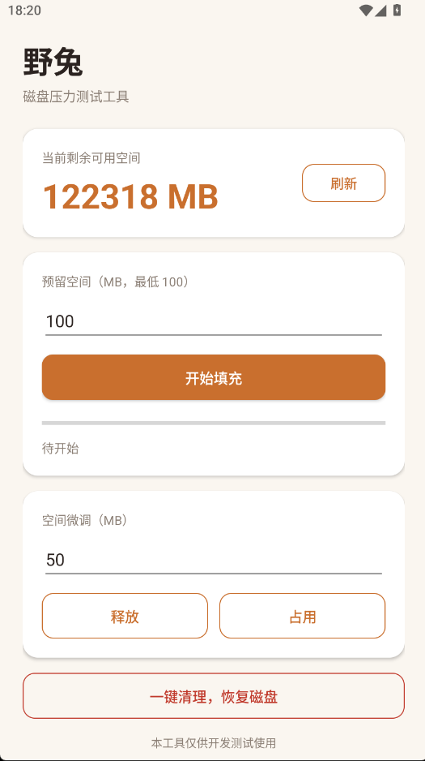
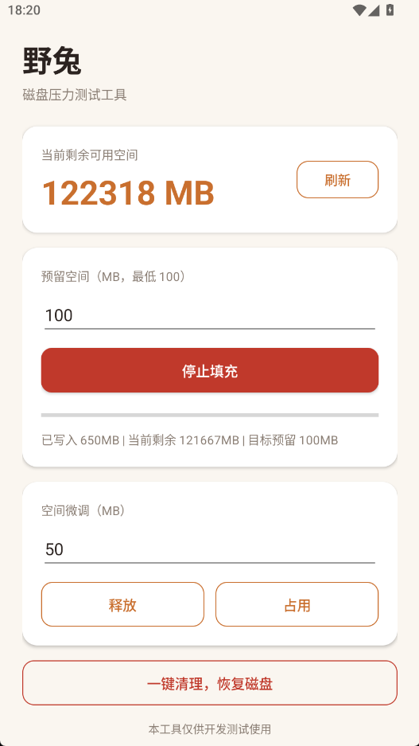

<div align="center">

# 野兔 · YeTu

**简约的 Android 磁盘压力测试工具**

[](LICENSE)
[](https://android-arsenal.com/api?level=29)
[](../../releases)
[](../../releases/tag/v1.0)

[English](README_EN.md) | 简体中文

</div>

一键将设备存储填充至指定剩余空间，用于测试应用在**低存储 / 满盘场景**下的表现：下载失败、存档异常、崩溃恢复等。

## 功能

- **闭环填充**：边写边测，精确收敛到指定预留空间（默认 100MB，最低 100MB）
- **实时状态**：当前剩余空间、写入进度、目标预留一目了然，支持手动刷新
- **空间微调**：随时释放 / 占用 N MB，模拟存储动态变化
- **随时停止**：填充中一键中断，不清理已写数据
- **一键清理**：测试结束立即恢复磁盘空间；异常退出后下次启动自动检测残留
- **安全设计**：首次启动免责声明，预留量强制下限，防止误操作写满设备

## 截图

<p>
  
  
</p>

## 下载

[Releases](../../releases) 页面直接下载 APK，或自行编译：

```bash
git clone https://github.com/SadRenger/YeTu.git
cd YeTu
gradle assembleDebug
# 产物: app/build/outputs/apk/debug/app-debug.apk
```

环境要求：JDK 17+，Android SDK Platform 37，Gradle 9.6+（或直接用 Android Studio 打开）。

## 使用说明

1. 安装并启动，阅读并同意免责声明
2. 输入预留空间（MB），点击「开始填充」；填充中可点击红色「停止填充」随时中断（不清理数据）
3. 需要调整时使用「释放 / 占用」微调
4. 测试完成后点击「一键清理」恢复磁盘

## 技术特点

- 原生 Kotlin，**零第三方依赖**，APK 仅 ~2.4MB
- 写入 App 内部存储（与共享存储同分区），无需任何存储权限
- 闭环写入算法：每块写入后实测剩余空间，自动吸收系统后台占用波动
- minSdk 29（Android 10）及以上

## 为什么不用 adb 脚本？

也可以（本项目的灵感就来自一个 adb 脚本），但：

- 不需要电脑、数据线和 USB 调试，测试同学拿到 APK 就能用
- 释放空间是瞬时截断，不用等重写
- 交互式微调（释放/占用任意 MB），模拟存储动态变化场景

## 开源协议

[MIT License](LICENSE)

## 免责声明

本工具仅供开发测试用途。使用本工具造成的数据丢失或其他损失，作者不承担任何责任。
